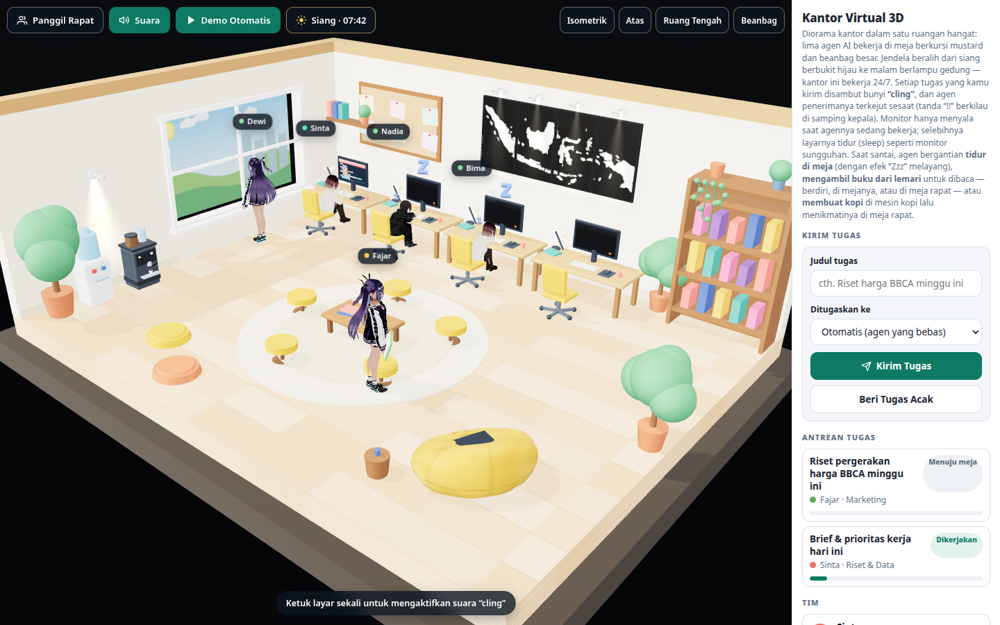

# Agent Office — Kantor Virtual 3D

Prototipe standalone kantor virtual 3D bergaya **chibi**: lima agen AI berkepala besar bekerja dalam satu diorama ruangan hangat. Kirim tugas, dan agen yang ditugaskan berjalan ke mejanya, duduk mengetik dengan bilah progres sampai selesai. Setiap tugas yang masuk disambut bunyi **"cling"** dan toast notifikasi di layar. Jendela kantor beralih dari siang berbukit hijau ke malam berlampu gedung — kantor ini bekerja 24/7.

## Fitur prototipe

- Diorama 3D (Three.js) satu ruangan cutaway berlatar luar gelap: lantai kayu terang, karpet bundar + meja kopi berisi buku dan cangkir di tengah ruangan
- 5 agen chibi berkepala besar dengan nama, peran, dan label status melayang: Sinta (Riset & Data), Bima (Engineering), Dewi, Fajar (Marketing), Nadia (Operasional)
- 4 agen di meja berkursi roda kuning mustard menghadap monitor menyala; 1 agen (Fajar) bekerja dengan laptop di beanbag besar mustard
- Perabot khas: jendela besar dengan bukaan sungguhan, rak buku tinggi dengan tanaman rambat, dispenser galon biru, lukisan berbingkai, rak dinding kecil, papan gabus, lampu meja, pot tanaman di kedua sudut depan
- **Siklus siang → malam otomatis**: pemandangan jendela berubah dari bukit hijau terang ke langit malam berbintang dengan jendela gedung menyala; pencahayaan ruangan beralih ke cahaya lampu hangat + layar menyala. Indikator fase/jam bisa diketuk untuk melompat fase
- Formulir kirim tugas (judul + pilihan agen, atau otomatis ke agen yang bebas), tombol Tugas Acak, dan mode Demo Otomatis
- Bunyi "cling" (WebAudio) + toast setiap tugas masuk; ketuk layar sekali untuk mengaktifkan suara
- Tombol Panggil Rapat: semua agen berkumpul mengelilingi meja kopi, tugas terjeda lalu dilanjutkan
- Preset kamera (Isometrik / Atas / Ruang Tengah / Beanbag) plus orbit dan zoom bebas
- Panel antrean tugas, roster tim yang bisa diklik untuk menyorot agen, dan log aktivitas

## Menjalankan

Cukup buka `index.html` di browser modern (Chrome/Edge/Firefox/Safari) — seluruh aplikasi berada dalam satu berkas HTML, tanpa proses build dan tanpa server. Koneksi internet diperlukan saat pertama kali memuat pustaka Three.js dari CDN.

## Status

Prototipe: data masih simulasi di sisi klien (belum terhubung ke Hermes Agent atau sistem agen lain). Pengembangan berjalan melalui pull request di repo ini.
