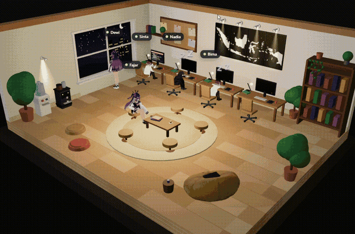

# Agent Office — Kantor Virtual 3D

Prototipe standalone kantor virtual 3D: lima agen AI bergaya **VRoid** (anime proporsi normal) bekerja dalam satu diorama ruangan hangat. Kirim tugas, dan agen yang ditugaskan berjalan ke tempatnya, duduk, dan bekerja dengan bilah progres sampai selesai. Setiap tugas yang masuk disambut bunyi **"cling"**, dan agen yang sedang santai akan **terkejut** (lencana "!!" + ekspresi kaget) sebelum mulai bekerja. Jendela kantor beralih dari siang berbukit hijau ke malam berlampu gedung — kantor ini bekerja 24/7.

## Fitur

- Diorama 3D (Three.js) satu ruangan cutaway berlatar luar gelap: lantai kayu terang, meja rapat bundar di tengah, rak buku, papan gabus, dan sudut minuman (dispenser galon + mesin kopi)
- 5 agen VRoid dengan nama, peran, label status (titik + nama), dan ekspresi wajah: Sinta (Riset & Data), Bima (Engineering), Dewi, Fajar (Marketing), Nadia (Operasional)
- 4 agen bekerja di meja berkursi kuning menghadap monitor; Fajar bekerja dengan laptop di beanbag besar — laptopnya tertutup di atas beanbag saat ia pergi, terbuka di pangkuan saat ia bekerja
- **Adegan santai saat tidak ada tugas**: tidur di meja (kepala bertumpu di lengan menyilang, huruf "Z" melayang), membaca buku dari lemari, membuat & menikmati kopi di meja rapat, dan menikmati pemandangan di jendela
- **Lukisan peta Indonesia 4 panel** di dinding belakang: siluet kepulauan digambar dari data garis pantai asli, putih di atas panel hitam, terpotong kontinu di batas panel — disinari **lampu sorot** berbentuk segitiga cahaya di atas tiap panel, plus satu lampu sorot di sudut minuman
- Monitor dan layar laptop **tidur** (gelap + titik standby oranye) saat agen tidak bekerja; layar yang menyala menampilkan kode yang sedang diketik
- **Siklus siang → senja → malam otomatis**: pemandangan jendela dan pencahayaan ruangan berubah mengikuti fase; indikator fase/jam bisa diketuk untuk melompat fase
- Formulir kirim tugas (judul + pilihan agen; tugas untuk agen yang sibuk otomatis dialihkan ke agen yang bebas), tombol Tugas Acak, dan mode Demo Otomatis
- Tombol Panggil Rapat: semua agen berkumpul mengelilingi meja rapat, tugas terjeda lalu dilanjutkan
- Preset kamera (Isometrik / Atas / Ruang Tengah / Beanbag) plus orbit dan zoom bebas
- Panel antrean tugas, roster tim yang bisa diklik untuk menyorot agen, dan log aktivitas

## Struktur

Versi GitHub Pages adalah bentuk terpecah dari satu berkas HTML agar ringan dibuka:

- `index.html` — kerangka halaman (5,6 KB)
- `style.css` — seluruh gaya (7,5 KB, sudah diminifikasi)
- `app.js` — seluruh logika aplikasi (sudah diminifikasi)
- `three.min.js` — pustaka Three.js
- `screenshot.png` — tangkapan layar di atas
- `assets/characters/` — model karakter yang dipanggil lewat path relatif:
  - VRoid AvatarSample (contoh resmi VRoid/pixiv): `AvatarSample_A.vrm`, `AvatarSample_B.vrm`, `AvatarSample_C.vrm` — teksturnya dikompres (total 43,6 MB → 21,9 MB) tanpa mengubah geometri/ekspresi
  - Sumber & lisensi tiap karakter: `assets/characters/CREDITS.md`

## Menjalankan

Halaman ini harus dibuka lewat server statis/hosting agar folder `assets/` terbaca oleh browser (membuka `index.html` langsung dari berkas/file:// akan gagal memuat model):

- **GitHub Pages**: https://ghozali25.github.io/agent-office/
- **Lokal**: jalankan server statis di folder ini, mis. `npx serve .` atau `python3 -m http.server`, lalu buka alamat yang diberikan.

## Status

Prototipe: data masih simulasi di sisi klien (belum terhubung ke sistem agen eksternal). Pengembangan berjalan melalui pull request di repo ini.
